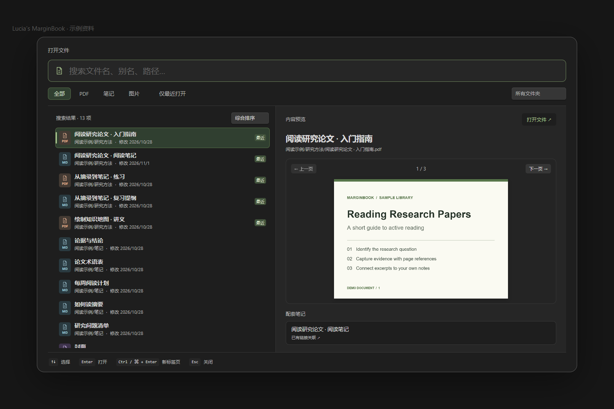

# Lucia’s MarginBook

**在 Obsidian 里读 PDF、做批注，把摘录整理成能回到原文的笔记和 Canvas 卡片。**

[下载最新版](https://github.com/elysiduck/lucias-marginbook/releases/latest) · [完整图文手册](lucias-marginbook-plugin/docs/user-guide.md) · [安装](#安装与更新) · [功能](#功能) · [更新日志](lucias-marginbook-plugin/CHANGELOG.md) · [问题反馈](https://github.com/elysiduck/lucias-marginbook/issues)

MarginBook 适合在 Obsidian 里读课件、论文和书籍。选中文字或框选页面区域，把摘录拖进 Markdown 或 Canvas；也可以直接在 PDF 页内写笔记、用笔做批注，再从侧栏回到对应页。打开下一份资料时，可以先在双栏选择器里看内容，再决定打开哪一个文件。



*文件选择器演示。左侧显示文件类型、路径和日期，右侧预览选中的资料。*

## 功能

| 功能 | 可以做什么 |
| --- | --- |
| **PDF 摘录** | 选中原文或框选图片，将摘录拖进 Markdown / Canvas，保留回到 PDF 对应位置的链接。可配置是否为文字摘录附截图。 |
| **批注侧栏与页注** | 按页查找摘录和批注、编辑 Markdown 备注，或直接在 PDF 的空白处放置独立页注。侧栏条目可折叠，点击可回到对应页。 |
| **手写与套索** | 使用笔压、跟笔稳定、整笔或局部橡皮和撤销重做。套索选中的笔迹可关联已有摘录，或作为独立手写笔记引用到 Canvas。 |
| **Canvas 知识整理** | 将摘录拖到卡片上建立父子关系，向右或向下整理成知识树。摘录卡支持补充描述和评论；需要复习时可开启回忆模式，点击揭示摘录。 |
| **双栏文件选择器** | 通过「打开文件」或快捷键进入。支持文件名、别名和路径搜索，筛选 PDF、笔记、图片、文件夹与最近打开记录。可按综合、最近打开、最近添加、最近修改或添加与修改中较新的时间排序。预览支持 PDF 翻页、Markdown 和图片。 |
| **AI 词汇卡（可选）** | 从 PDF 选中单词或短语，生成释义、原句翻译、例句和助记，保存到 Markdown。可修改生成要求，按需重新查询。 |
| **插入 PDF 空白页** | 在 PDF 缩略图菜单中选择在该页之前或之后插入空白页。此操作会修改原 PDF；插件先备份，并更新已知的 MarginBook 页码引用。 |

## 安装与更新

目前从 **GitHub Releases 手动安装**：

1. 打开[最新版 Release](https://github.com/elysiduck/lucias-marginbook/releases/latest)，在 **Assets** 下载 `lucias-marginbook-<版本>.zip`。
2. 解压，将其中的 `lucias-marginbook` 文件夹放进你的 Obsidian 库的 `.obsidian/plugins/`。确认文件直接位于 `.obsidian/plugins/lucias-marginbook/main.js` 和 `.obsidian/plugins/lucias-marginbook/manifest.json`。
3. 在 Obsidian 的 **设置 → 第三方插件** 中允许第三方插件，启用 **Lucia's MarginBook**。如果列表未刷新，重新打开 Obsidian。

**升级已有版本：**备份插件目录，停用插件，仅替换安装包里的 `main.js` 和 `manifest.json`，然后重新启用。保留现有的 `data.json`、手写数据和备份目录。不要下载自动生成的 **Source code** 压缩包来安装。

插件清单的最低 Obsidian 版本为 **1.5.0**；建议使用近期版本。PDF、主题、移动端手势和触控笔行为由 Obsidian 宿主决定，具体设备上的体验可能不同。

## 快速上手

1. **找资料。** 按 **Ctrl+K**（macOS：**⌘K**）或点「打开文件」。用 **↑↓** 切换预览，**Enter** 打开，**Ctrl/⌘+Enter** 在新标签页打开。快捷键冲突时，在 Obsidian 设置里搜索「打开文件（预览选择器）」并指定快捷键。
2. **摘录和回跳。** 打开 PDF，选中文字，或从工具栏打开图片框选模式。把摘录拖到 Markdown 或 Canvas；用摘录上的链接跳回原文。
3. **记下自己的理解。** 打开 PDF 批注侧栏编辑备注，或从工具栏选择「新建 Markdown 页注」，点页面空白处开始输入。需要手写时，切换到「PDF 手写批注模式」。
4. **按需查词。** 在插件设置的「AI 词汇卡」填写兼容 Chat Completions 的 API 地址、模型和所需密钥，测试连接后，选中 PDF 原文里的词语，点击浮动工具栏的查词按钮。

## 数据存放与联网

- **摘录、备注和 Canvas 在你的 Obsidian 库中。** 新安装默认采用集中存储，按 PDF 来源目录和文件名组织笔记、Canvas 与附件；原 PDF 保持原位置。旧库的存储布局不会因升级自动搬迁。
- **页注和手写是阅读器里的覆盖层。** 它们不会直接嵌入原 PDF；「插入空白页」是单独的原文件编辑操作。
- **AI 词汇卡是可选联网功能。** 只有主动查词或测试连接时才发请求。可关闭发送原句语境；API Key 保存在本地插件配置中，未加密，不要公开或分享 `data.json`。

## 使用手册

**[打开完整图文手册](lucias-marginbook-plugin/docs/user-guide.md)**：按阅读场景查找入口、操作步骤和设置，附文件选择器、PDF 摘录与页注、手写、Canvas、AI 词汇卡及插页截图。

- [文件预览与排序](lucias-marginbook-plugin/docs/file-picker.md)
- [PDF 页注和 Markdown 备注](lucias-marginbook-plugin/docs/markdown-pdf-notes.md)
- [手写关联、侧栏预览和 Canvas 引用](lucias-marginbook-plugin/docs/ink-associations.md)
- [AI 词汇卡与自定义助记](lucias-marginbook-plugin/docs/ai-word-cards.md)
- [存储目录与旧库迁移说明](lucias-marginbook-plugin/docs/central-storage.md)
- [PDF 空白页插入、备份与恢复](lucias-marginbook-plugin/src/README.md#pdf-blank-pages)

## 开发与反馈

插件源码在 [`lucias-marginbook-plugin/src/`](lucias-marginbook-plugin/src/)。使用 Node.js 18 或更高版本：

```sh
cd lucias-marginbook-plugin
npm run build
npm run verify
```

`main.js` 由构建生成。[更新日志](lucias-marginbook-plugin/CHANGELOG.md)记录了功能变更和验证范围。遇到问题请在 [Issues](https://github.com/elysiduck/lucias-marginbook/issues) 提供 MarginBook 版本、Obsidian 版本、系统和可复现步骤；截图和日志请先移除私有路径、笔记内容及 API Key。

随插件打包的 PDF 处理库及其许可见 [第三方许可说明](lucias-marginbook-plugin/src/vendor/pdf-lib.LICENSE.md)。
