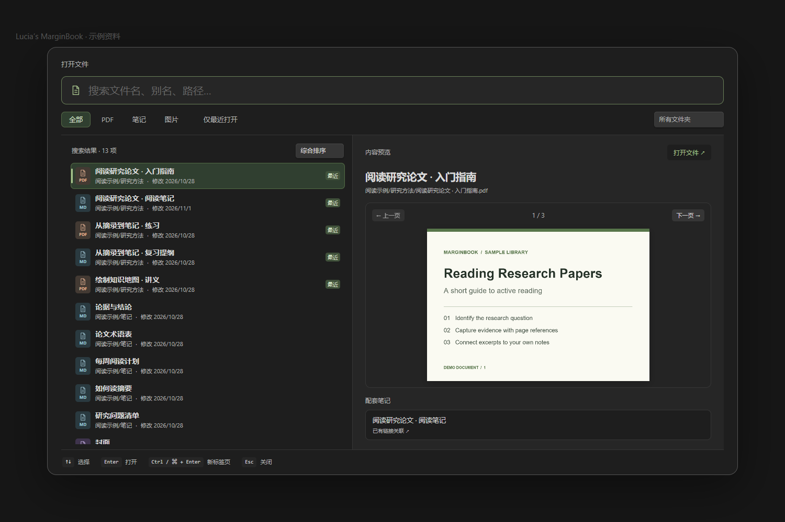
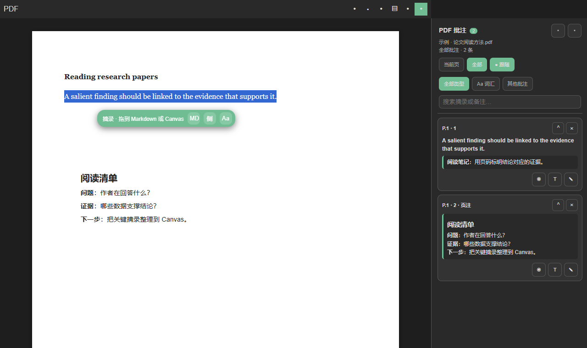
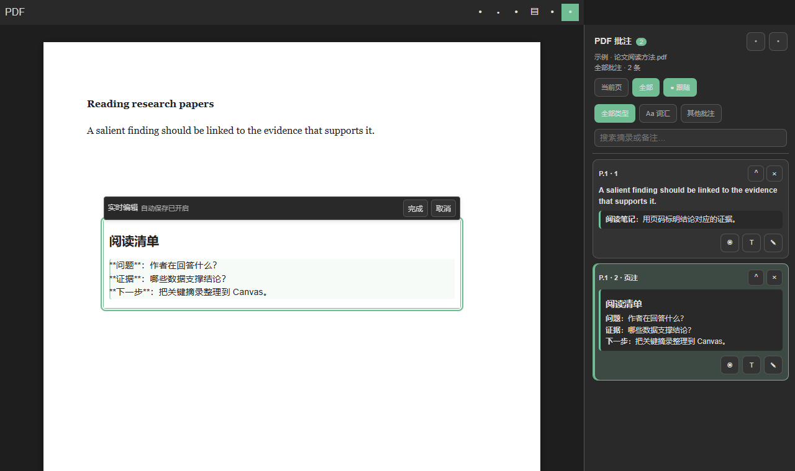
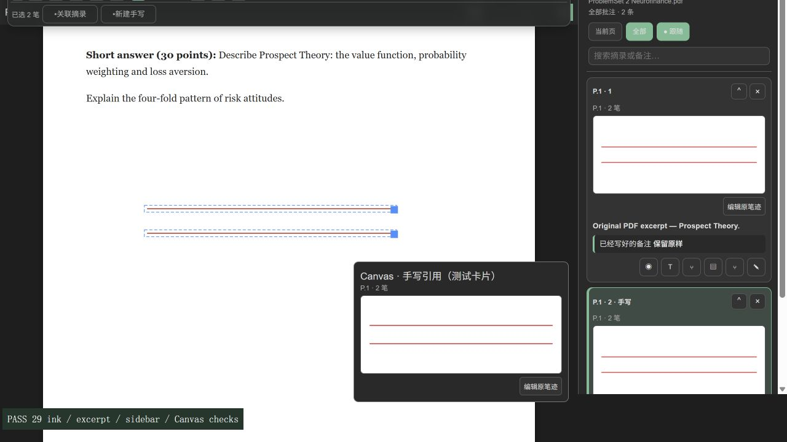
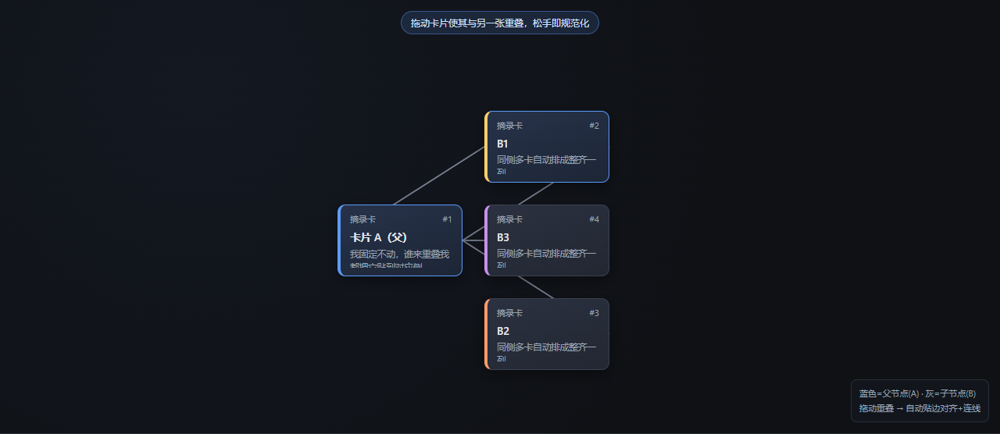
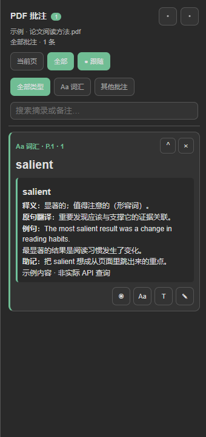
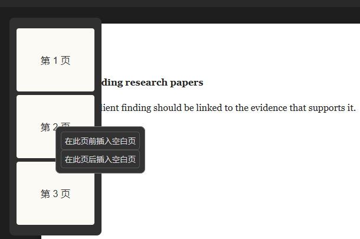

# Lucia’s MarginBook 图文手册

适用于 **0.48.1**。这份手册按实际使用顺序组织：找资料、做摘录和页注、手写、整理画布，再到查词与管理数据。截图使用示例资料；浏览器演示中的图标和主题可能和你的 Obsidian 不同。

[下载与安装](#1-下载与安装) · [文件选择器](#2-找资料和预览) · [PDF 摘录](#3-pdf-文字与图片摘录) · [侧栏与页注](#4-批注侧栏和-markdown-页注) · [手写](#5-手写批注和套索) · [Canvas](#6-在-canvas-上整理) · [AI 词汇卡](#7-ai-词汇卡) · [插入空白页](#8-在-pdf-中插入空白页) · [设置与维护](#9-设置与维护)

## 1. 下载与安装

1. 从 [GitHub Releases](https://github.com/elysiduck/lucias-marginbook/releases/latest) 的 **Assets** 下载插件 ZIP。自动生成的 Source code ZIP 是源码包。
2. 解压后将 `lucias-marginbook` 文件夹放入库的 `.obsidian/plugins/`。确认 `main.js` 和 `manifest.json` 位于该文件夹内，没有多嵌套一层目录。
3. 打开 **设置 → 第三方插件**，允许第三方插件并启用 **Lucia's MarginBook**。看不到插件时重新打开 Obsidian。升级时先备份目录，只替换这两个运行文件，保留 `data.json`、笔迹和备份目录。

第一次试用时，可以在一份示例 PDF 中选一句话，点浮条的「创建简洁摘录到 PDF 侧栏」，再从侧栏点回原文。想继续把它整理成 Markdown 或 Canvas 卡片，再用完整摘录。

## 2. 找资料和预览

点击原来的「打开文件」或按 **Ctrl+K / ⌘K**。也可以在命令面板搜索「打开文件（预览选择器）」；快捷键冲突时在 Obsidian 中重绑。

- **搜索**匹配文件名、路径和 Markdown 别名。输入多个词时可以换顺序。
- **筛选**支持全部、PDF、笔记、图片、文件夹和「仅最近打开」。筛选可以叠加。
- **排序**在左栏结果数旁。综合排序依次考虑匹配程度、打开记录与修改时间；最近打开按历史顺序；最近添加用文件创建时间；最近修改用修改时间；添加或修改用两者较新的时间。同步、复制或迁移可能改变创建时间。本次 Obsidian 会话中重新打开选择器会记住排序。
- **预览**：单击或按 **↑↓** 选择，右侧可翻看 PDF、阅读 Markdown、查看图片，以及打开链接关联或同目录命名匹配的配套笔记。长标题和路径仍可在右侧或悬停查看。
- **打开**：**Enter** 或双击在原标签页打开；**Ctrl/⌘+Enter** 或 **Ctrl/⌘+单击**在新标签页打开；**Esc** 关闭窗口。

## 3. PDF 文字与图片摘录

*图中 MD、侧和 Aa 对应完整摘录、简洁摘录与 AI 查词；实际按钮以悬停提示为准。*

| 要做什么 | 操作 | 结果 |
| --- | --- | --- |
| 记下一段可继续整理的原文 | 选中文字，点浮条「创建完整摘录到摘录文档」，或把浮条拖到 Markdown／Canvas | 摘录带原文回跳链接。文字可按设置自动附截图；已有截图的卡片能切换文字／图片视图。 |
| 只想在阅读时做个标记 | 点「创建简洁摘录到 PDF 侧栏」 | 保存在插件数据中，显示在当前 PDF 的批注侧栏，不额外创建 Canvas 卡片。 |
| 摘录图表、公式或无法选中的区域 | 开启 PDF 工具栏或应用侧边按钮的「图片框选」，在 PDF 上拖出矩形；桌面也可 **Alt+拖拽** | 生成区域截图。再点开关或按 **Esc** 退出持续框选。 |
| 复制回跳引用 | 选中原文后运行「复制当前 PDF 选区为引用块（含回跳链接）」 | 粘贴到已有笔记，保留原文来源。 |
| 在移动端送入画布 | 选中后使用浮条的「加入 PDF 专属画布」 | 无需依赖桌面拖拽。 |

PDF 顶栏还有「打开当前 PDF 的摘录文档」和打开或创建专属 Canvas 的入口。摘录可改色；文字摘录通常用高亮，纯图片摘录的原文定位可设为虚线框或半透明高亮。从 Markdown 或 Canvas 点回跳链接可定位 PDF；从 PDF 摘录标记也能定位已建立索引的笔记或卡片。既有 PDF++ `selection=` 格式链接可继续用于定位。

## 4. 批注侧栏和 Markdown 页注

- **浏览与定位**：从 PDF 顶栏开关「PDF 批注」侧栏。选「当前页」或「全部」，可打开「跟随」、按词汇／其他批注筛选并搜索摘录或备注。点击卡片定位原文；标题区可切换侧栏左右位置，边缘可拖宽，收起后仍有展开入口。
- **给已有摘录加备注**：在侧栏点添加或编辑备注。点「将 Markdown 备注放到 PDF 页面」后，再点页内位置。一个备注只保留一个页内位置；重新放置会移动该块。
- **新建独立页注**：点 PDF 顶栏「新建 Markdown 页注」，再点页内空白处。无需选原文；保存后在 PDF 和侧栏显示。未放置前可用 **Esc** 取消。
- **调整和编辑页内文字块**：单击选中并显示工具栏；双击正文或选中后按 **Enter / F2** 编辑。拖手柄移动、拖右边缘改宽度，字号可通过 **A− / A+** 或数值调整，也可切换样式。表格、列表、代码和公式按块编辑。
- **保存与取消**：停止输入约 800 ms 后自动保存；「完成」或 **Ctrl/⌘+Enter** 立即保存。取消只丢弃最后一次成功保存后的改动。切换条目前会先保存当前内容；保存失败会保留草稿。
- **收起、移除与删除**：侧栏收起只压缩列表条目；页内「移除」只取消摆放，保留备注；删除条目才会删除对应记录。页内文字是可编辑覆盖层，不写入原 PDF。

## 5. 手写批注和套索

*历史演示截图说明三处如何关联；当前版本增加了拖到摘录、继续手写和解除关联等操作。*

1. 在 PDF 工具栏开启 **PDF 手写批注**。可选画笔、荧光笔、直线、矩形、文字或橡皮；抓手用于浏览，桌面也可按住空格临时启用。颜色、粗细和更多选项在手写工具栏。
2. 用「选择 / 套索」框住一组笔迹，可移动、缩放或删除选中笔迹。橡皮可局部擦除或整笔擦除；工具栏和命令面板可撤销、重做，命令面板还能清除当前页手写。
3. 套索后点击「关联摘录」再选侧栏卡片，或用「拖到摘录」将选中的笔迹关联到已有条目；也可以「新建手写」，给笔迹单独命名。关联不会覆盖原摘录和备注。
4. 点击侧栏笔迹预览可定位；「继续手写」会将新笔迹加入同一关联，点「完成续写」后新增笔迹保持独立。「解除关联」只去掉引用，保留笔迹与备注。
5. 从侧栏将手写引用加入 Canvas 后，卡片预览会跟随原笔迹变化；在 Canvas 中点击预览可回到原位置。它引用的是原始笔迹，不是单独复制一张截图。

设置可选「触控笔和鼠标」或「仅触控笔」、自然压感／钢笔效果／固定宽度、四档跟笔稳定、橡皮范围及擦完自动回画笔。手指用于滚动和双指缩放；实体触控笔体验取决于设备。笔迹存放在库的插件数据中，不写进原 PDF。

## 6. 在 Canvas 上整理

*布局原型截图，用于说明父子关系与贴边效果，不是 Obsidian 的原生界面。*

1. 在 PDF 顶栏打开专属 Canvas，或打开你自己的 Canvas。把摘录拖到空白处创建独立卡片；拖到已有卡片上可建立父子连线并按放下方向贴边布局。已建立关系的子卡可拖回父卡并改变挂靠侧。
2. 选中卡片会出现可用的悬浮操作：**评论、跳转、视图、颜色、高度、联动、断开**。有附图才能在文字／图片间切换；「联动」让拖动父卡时带上子卡；「断开」按提示选择连线，不删除卡片。
3. 命令面板可运行「将当前 Canvas 排为从左到右知识树」或「从上到下知识树」，也可规范化已经重叠的摘录卡、按内容自适应卡片高度。
4. **补充描述**是随卡片保存的可折叠 Callout，可配置是否同步到摘录文档；**评论**有独立编辑入口和存储。命令面板支持添加、编辑、移除，或给整个画布批量补上描述框、评论栏。
5. 需要自测时，运行「回忆模式：开关」，将支持的摘录模糊显示，点一下临时揭示。可在设置中配置默认开启与颜色语义。

## 7. AI 词汇卡

1. 打开 **设置 → Lucia's MarginBook → AI 词汇卡**，填写兼容非流式 Chat Completions 的接口地址、模型名称及服务所需的 API Key，点击「测试 AI 连接」。
2. 在 PDF 中选中单词或短语，点浮条的 **Aa 查词建卡**。支持短选区（最多 160 字符、12 个词）；图片选区没有查词入口。
3. 结果写入摘录文档的词汇卡区域，在侧栏用 **Aa 词汇**筛选。可编辑、折叠、放到页内或定位原词。同一选区重复查询会找到已有卡片；重新查询已有内容时先预览再决定是否替换。
4. 「自定义生成要求」可以改写解释与助记风格，支持恢复默认示例；修改提示词不会批量改写历史卡片。

只有主动查词或测试连接才联网。可关闭「发送原句语境」以只发送选中词语；生成内容不等同于词典条目。密钥在本地 `data.json` 中未加密，分享或同步配置时留意这一点。

## 8. 在 PDF 中插入空白页

打开 **PDF 缩略图**，右键目标页（触控或笔可长按），选择「在此页前插入空白页」或「在此页后插入空白页」。空白页沿用相邻页尺寸与方向，原 PDF 路径不变。

这项操作会修改 PDF 本身。插件先保存编辑器与笔迹，再备份受影响文件，更新已知的摘录、页注、手写关联及解析到的 Markdown／Canvas 页码链接。加密 PDF 和检测到的签名 PDF 不支持此操作。其他插件的私有页码记录可能需要自行核对。备份在插件目录的 `page-backups/`；恢复细节见[空白页插入和恢复说明](../src/README.md#pdf-blank-pages)。

## 9. 设置与维护

| 设置组 | 可以调什么 |
| --- | --- |
| 常规与调试 | 查看运行版本、开关调试提示。 |
| AI 词汇卡 | 接口、Key、模型、语境开关、自定义生成要求、恢复默认和测试连接。 |
| 颜色与回忆 | 颜色语义映射、是否默认开启回忆模式。 |
| PDF 手写 | 输入设备、笔压、跟笔稳定、橡皮命中范围与模式、擦完自动回画笔。 |
| 摘录卡片与附件 | 新卡片统一宽度、文字摘录是否附截图、集中工作区或旧版截图目录、纯图片摘录的原文标记、删除卡片时是否级联清理。 |
| 卡片补充描述 | Callout 类型、标题、默认折叠、同步进摘录文档、是否自动挂空描述框与评论栏。 |

**数据放在哪里：** 新安装默认按来源目录和 PDF 名称集中保存摘录 Markdown、Canvas 和附件，原 PDF 保持原位。旧库升级不会自动搬迁或合并历史摘录。页内布局、简洁摘录及插件偏好在插件配置中，手写另有笔迹数据；移动库或更换设备时，除 PDF、Markdown、Canvas 和附件，也要保留对应插件数据。

**删除与恢复：**「删除卡片时级联清理」默认关闭。开启后，删除 Canvas 摘录卡可能移除对应 Markdown 条目，并把符合条件的插件附件移入 `.lmb-trash`；其他笔记仍在引用或无法确认引用时会保留截图。仅想整理连线时用「断开」，不用删除卡片。

**定位异常时：** 在命令面板可执行「重建摘录索引」「显示摘录索引统计」「强制刷新摘录标记」。可先确认 PDF 是否同名、已移动或已换页，再检查对应的摘录链接。

进一步阅读：[文件选择器](file-picker.md) · [Markdown 页注](markdown-pdf-notes.md) · [手写关联](ink-associations.md) · [AI 词汇卡](ai-word-cards.md) · [集中存储](central-storage.md) · [索引与定位](pdf-reference-indexing.md) · [更新日志](../CHANGELOG.md)。
